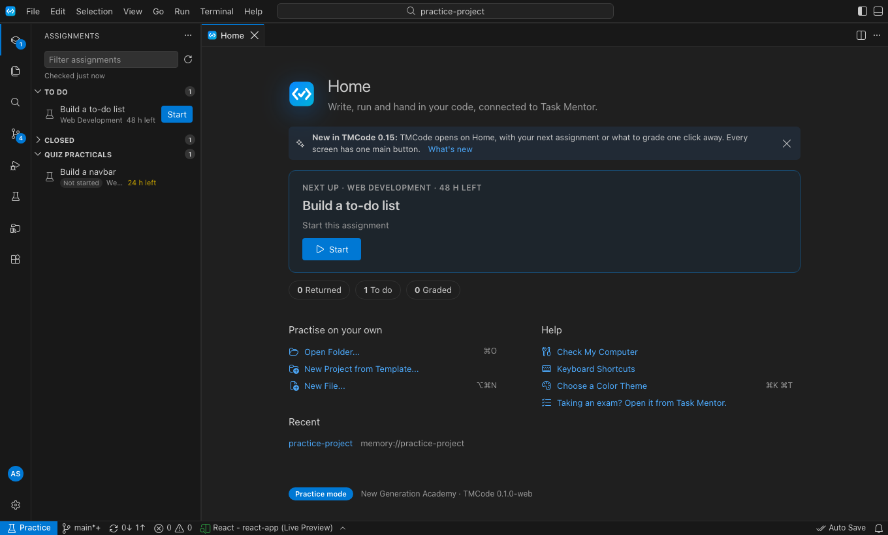
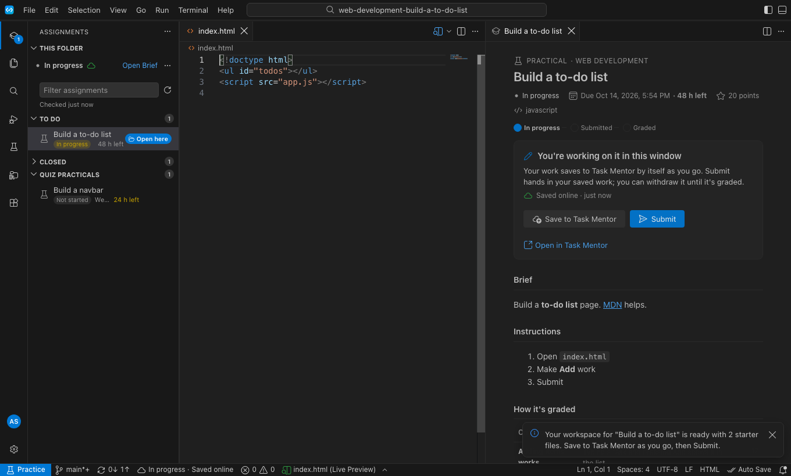
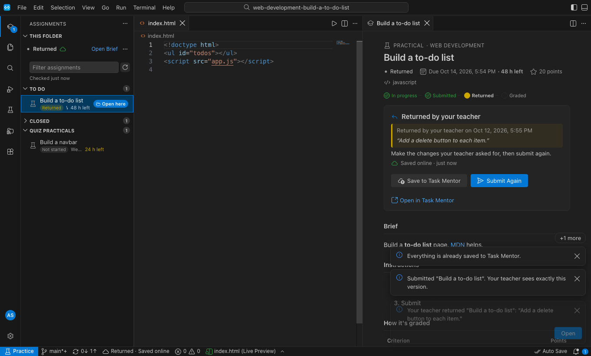

# Getting started with TMCode (students)

TMCode is where you write, run and hand in the code your teachers set in Task Mentor.

## 1. Open TMCode and sign in

TMCode opens on **Home**. The first time, choose **Sign in** and finish in your browser with your NGA account.

## 2. Start your next assignment

Home shows **Next up**: work your teacher returned comes first, then the assignment due soonest. Choose **Start** (or **Continue** if you already began). TMCode makes your own project from your teacher's starter files and opens the brief beside your code.

Below it, **Returned**, **To do** and **Graded** open your list in Assignments (the first icon on the left).

## 3. Work, save, submit

- Your work saves to Task Mentor by itself. The brief says where it is: "Saved online · 2 min ago".
- **Submit** on the brief hands in your saved work. You can **Withdraw to Edit** until it's graded.
- The side bar shows one line: your status and where your work is. **Open Brief** brings the brief back.

## 4. Returned or graded

- If your teacher **returns** your work, you get a message that stays until you've seen it, and the brief shows what to change with **Submit Again**.
- When it's **graded**, the score, feedback and criteria are at the top of the brief.

## Quiz practicals

Quiz practicals are in Assignments too, with the same brief. First **open the quiz in Task Mentor** (Open Quiz), then Start, work and Submit in TMCode.

## Good to know

- The bell (bottom right) keeps your messages for 30 days.
- Practising on your own: **Open Folder** or **New Project from Template** on Home.
- Exams open from Task Mentor, never from Home.
