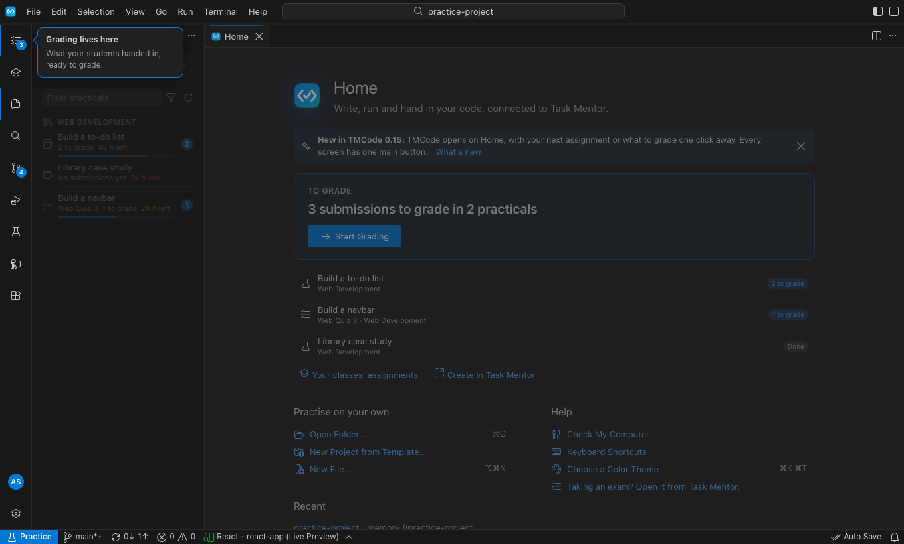
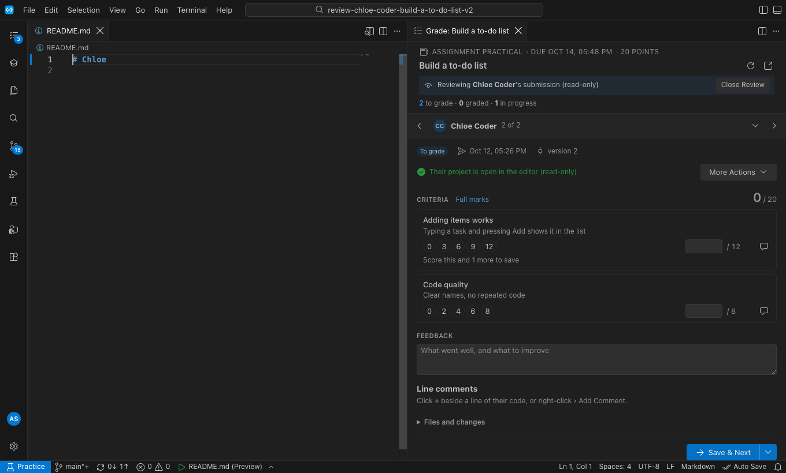
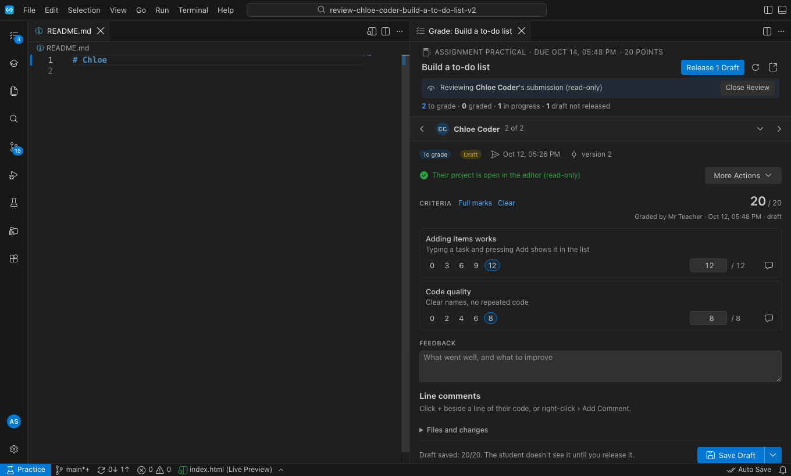

# Getting started with TMCode (teachers)

TMCode lets you grade your students' TMCode practicals beside their code.

## 1. Open TMCode and sign in

TMCode opens on **Home**. After your first sign-in it remembers that you teach, so **Grading** is the first icon on the left from the start.

## 2. Start grading

Home says what waits, for example "3 submissions to grade in 2 practicals · 1 draft not released". **Start Grading** opens the oldest waiting submission straight away. In Assignments, **Grade (2)** on a row does the same for that assignment.

While you review, the side bar and the student list fold away so the code gets the width. The switcher at the top (‹ Ben Learner 1 of 2 ›) moves between students. Settings › Grading › Focus While Reviewing turns this off.

## 3. Grade

The panel reads top to bottom: **Criteria**, **Feedback**, **Line comments** (hover a line in the code and choose +), then **Files and changes**.

- **Save & Next** (⌘Enter / Ctrl+Enter) saves and opens the next waiting student. Its ▾ menu has **Save Draft** (the student doesn't see it yet) and **Save & Release**; your last choice becomes the main button.
- **Release N Drafts** at the top shows your draft grades to their students.
- **More Actions** has Preview the Website, Compare with Version, **Return for Changes** and Shortcuts.

## 4. Finish

**Close Review** (top of the grading tab) takes you back to the folder you had open.

## Good to know

- The bell keeps messages for 30 days; Released and Returned messages stay until you close them.
- Your Assignments list shows your classes first, with each student's progress on the assignment page.
