# TMCode 0.15 through an end user's eyes: gap analysis

**Date:** 12 October 2026 · **Version reviewed:** TMCode 0.15.0 (just released) · **Follows:** [2026-10-12 workflow gap analysis](../2026-10-12-workflow-gap-analysis/README.md) and its [implementation plan](../../plans/2026-10-12-workflow-ux-implementation-plan.md)

## Summary

0.15 fixed what the first review asked for. TMCode now opens on Home, every screen shows one status, and grading starts in one click. But using it as a student and as a teacher shows a different problem: **the screen asks the eye to watch too many things at once.** Each piece is right on its own. Together they compete.

The five things an end user feels most:

1. **Messages pile up and cover the work** (U1). By the time a student is graded, three or four old messages ("Submitted…", "Your teacher returned…", "…was graded") are stacked over the bottom of the brief and over Home's **Start** button. Some are already untrue: the work was returned, then graded, and the "returned" message is still there.
2. **"Is my work safe?" has three answers on one screen** (U2). The status bar says **Auto Save ✓**, the side bar and status bar say **Not saved yet**, and a moment earlier the brief said **Saved online · just now** while the student was still typing. There are three layers of saving (editor, disk, Task Mentor), and the student sees all three.
3. **On a small laptop the main button disappears** (U3). At 900 × 640 the screen splits into side bar, code and brief. The code gets about 300 px, and **Submit is below the fold**, under a message.
4. **Running the code hides the brief** (U4). Live Preview takes the brief's place, so the only Save and Submit buttons vanish until the student finds the brief's tab again.
5. **Teachers see three different numbers for one practical** (T1). On one screen the list says "0/24 submitted", the button says **Grade (1)**, the cards say "0 Started · 0 Submitted", and the table says "Ada Student · Submitted".

The fix isn't more features. It's **arrangement**:
- a two-pane "work mode" (code | brief, or code | grade) whose main button is always visible;
- one message per assignment, retired once the screen shows the same thing;
- one saving story;
- a simpler default screen for students.

These are set out in [Proposed refactor](#proposed-refactor-the-arrangement) and [Plan](#plan). Roughly 12–16 developer days.

---

## How this was tested

- **As an end user:** a first-time student (signed out → sign in → next assignment → work → run → submit → returned → graded → quiz practical) and a teacher (Home → grade → Save & Next → more actions → student list → close review → Assignments). Every screen was captured and read as a user would, not from the code.
- **Window sizes:** 1280 × 720 (common school laptop), 1100 × 680 and 900 × 640 (small laptops, split screens).
- **Build:** the browser build with the in-memory test server (the same one the e2e tests use).
- **Caveats:**
  - The browser build always opens a demo folder with a git repository, so some first-launch screens (the Explorer, git badges) look busier than a fresh desktop install.
  - The test server's teacher counts are partly fixed numbers, which exaggerates T1. The problem underneath is real, though: the screen reads three sources.
  - Not checked here: the installed desktop app, light and high-contrast themes, keyboard-only use, screen readers, and real Task Mentor latency.

---

## The student's day, step by step

### 1. First launch, then sign in

| Before sign-in | Just after sign-in |
|---|---|
| 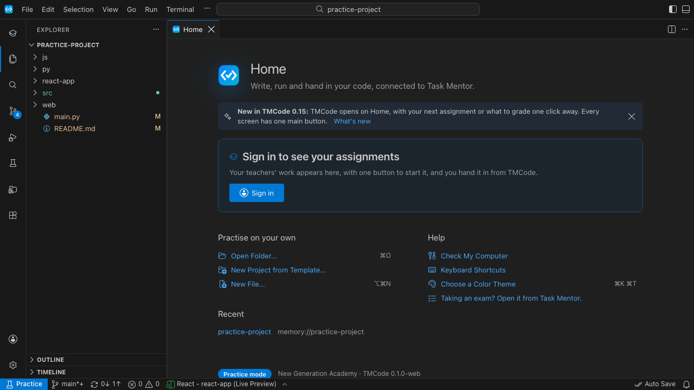 | 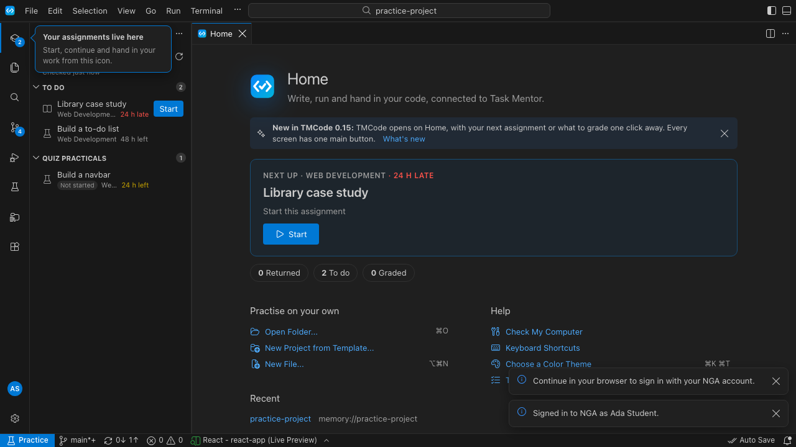 |

- Good: one clear card, **Sign in**.
- After signing in, two messages appear for one event ("Continue in your browser to sign in…" and "Signed in to NGA as Ada Student"). The first is now wrong and stays (U11).
- The "Your assignments live here" pointer sits over the side bar's filter and "Checked just now" line at the moment the list appears (U10).
- Nine unlabelled icons on the left. The demo folder shows a Source Control badge (4) the student never asked for (U10).

### 2. Start the next assignment

| Next up was an overdue case study with no starter files | After closing the picker |
|---|---|
| 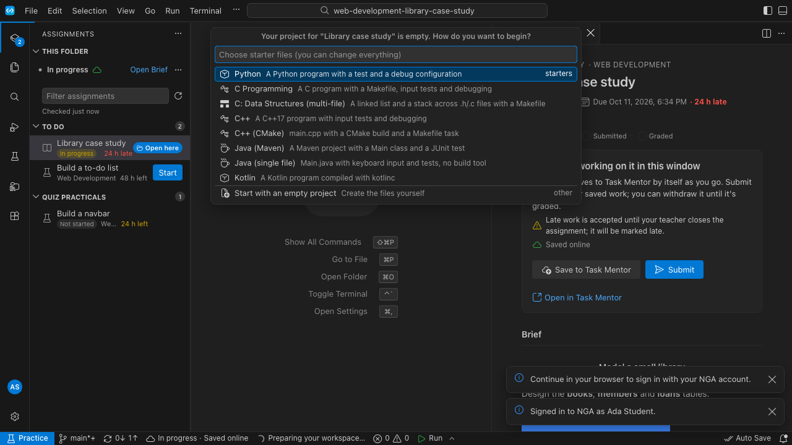 | 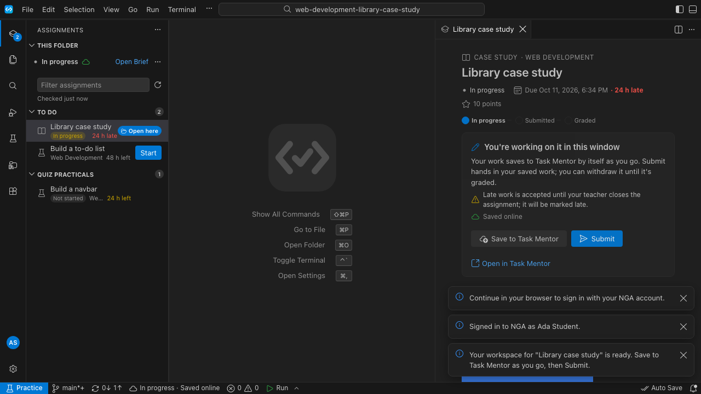 |

- **Start** leads straight to a nine-item list of *programming languages* (Python, C, C++, Java, Kotlin…) for a case study about designing a library database. The list doesn't match the work (U6).
- Closing the list leaves an **empty editor** full of keyboard shortcuts, while the brief's main button is **Submit**, for a project with no files (U6).
- Three messages are already stacked over the brief (U1).

### 3. Look at another assignment while working

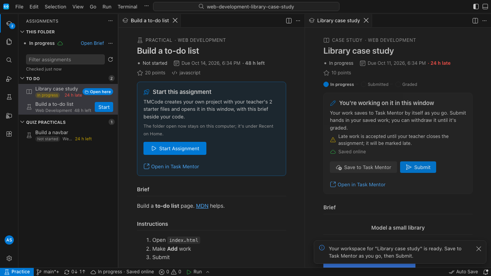

Clicking "Build a to-do list" in the list opens its brief **in a new column beside the other brief**, and the code disappears. The student now sees two assignments side by side, one "Not started" and one "In progress", and can't tell which one the open folder belongs to (U5).

### 4. Work and run

| Typing (file not saved yet) | After Run (F5) |
|---|---|
| 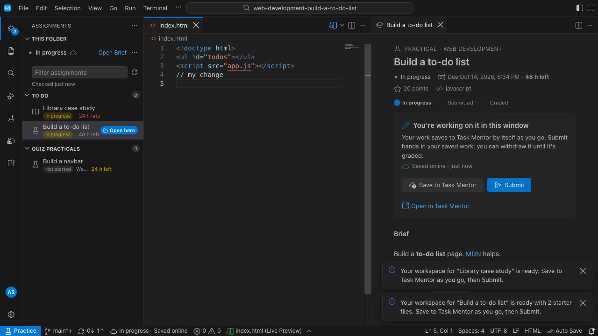 | 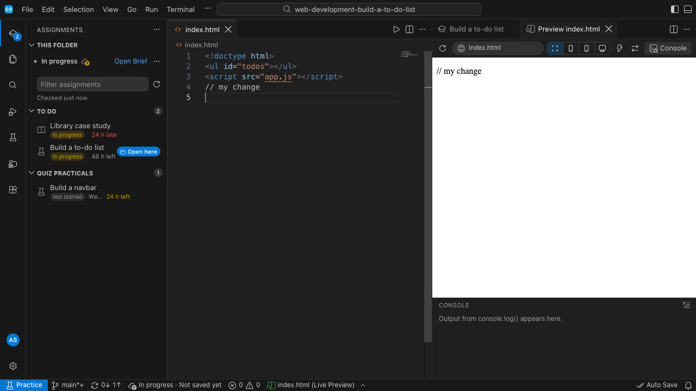 |

- While typing, the brief says **Saved online · just now**. After Run, the status bar says **Not saved yet** next to **Auto Save** (U2).
- Live Preview replaced the brief. **Save and Submit are gone** until the student finds the "Build a to-do list" tab again (U4).

### 5. Submitted → returned → graded

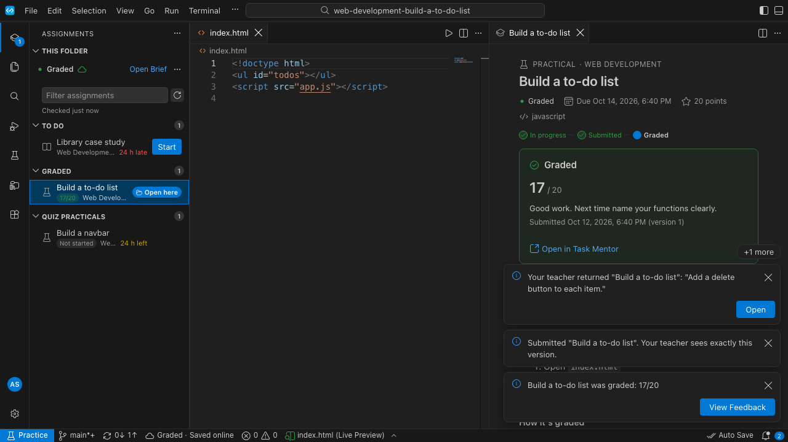

- The one status everywhere works: header, card, steps, row and status bar all say Graded.
- But four messages (three shown and "+1 more") cover the lower half of the brief. The returned message, with its **Open** button, is still there after the grade (U1).
- The row reads "Returned \ 48 h left": the course name is squeezed to a sliver beside the **Open here** pill (U12).

### 6. Notification centre

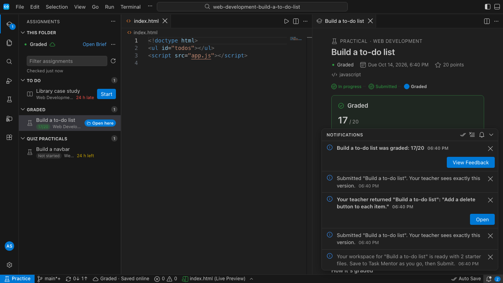

"Submitted 'Build a to-do list'…" appears twice, and the returned entry still offers **Open** after the work was graded. History is useful; duplicates and out-of-date buttons are noise (U13).

### 7. Coming back to Home later

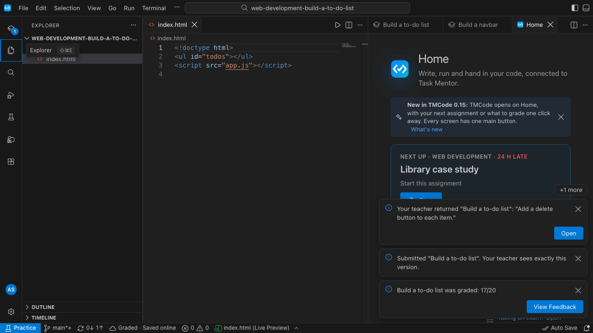

**Help › Home** opened Home **inside the narrow brief column**, next to two other brief tabs, and the stale messages cover its **Start** button (U5, U1).

### 8. A small laptop

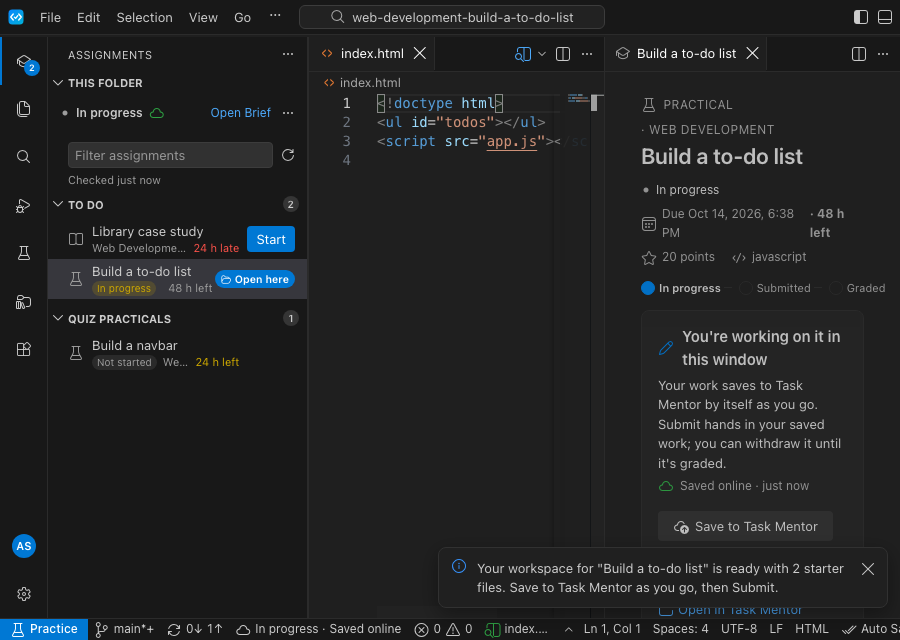

At 900 × 640: side bar 260 px, code about 300 px, brief about 300 px. Submit is below the fold, behind a message. The student has to scroll a panel they may not know scrolls (U3).

---

## The teacher's day, step by step

| Home | First student (one click) |
|---|---|
| 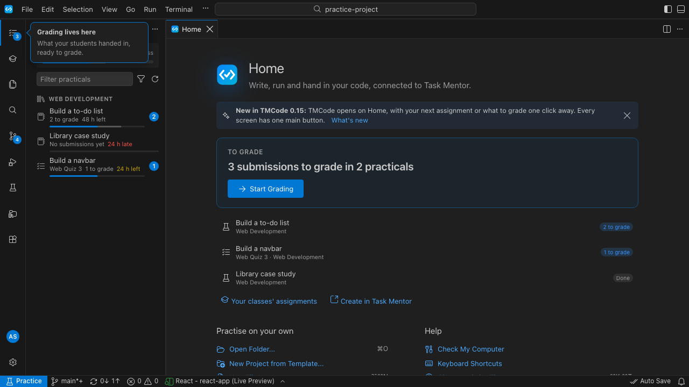 | 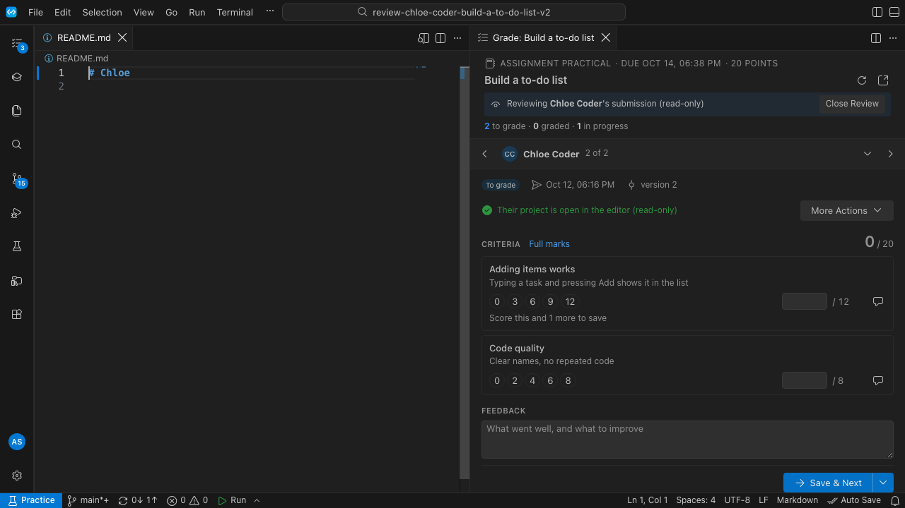 |

- Good: "3 submissions to grade in 2 practicals" with **Start Grading**, and the first student opens in one click.
- Home marks "Library case study" as **Done** although **nobody has submitted** (T8).
- The first student opened is labelled **"2 of 2"**, so the teacher's first student looks like the last one (T3).
- The review opened `README.md`, not the student's code (T7).

| After Save & Next | Student list opened |
|---|---|
| 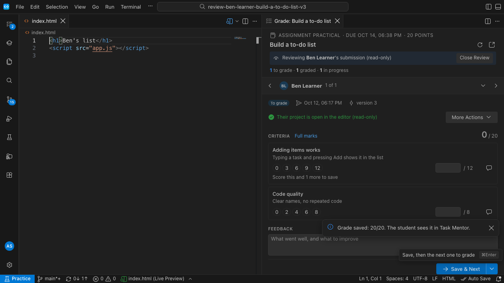 | 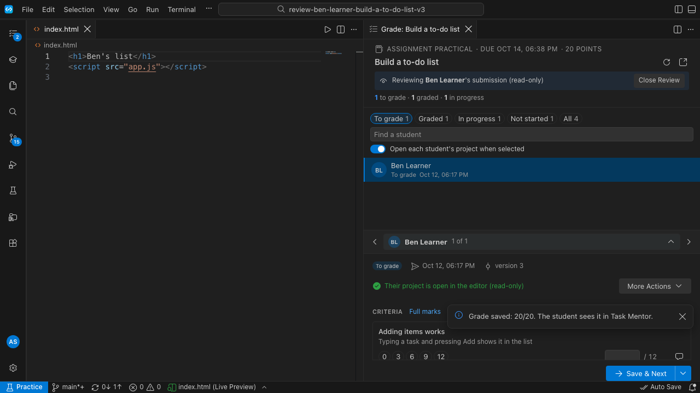 |

- After Save & Next the counter says "1 of 1"; a moment ago it said "2 of 2" (T3).
- The "Grade saved" message sits on the Feedback box (T9).
- Opening the student list pushes the grade panel below the fold of the narrow tab (T4).

| After Close Review | The assignment page |
|---|---|
| 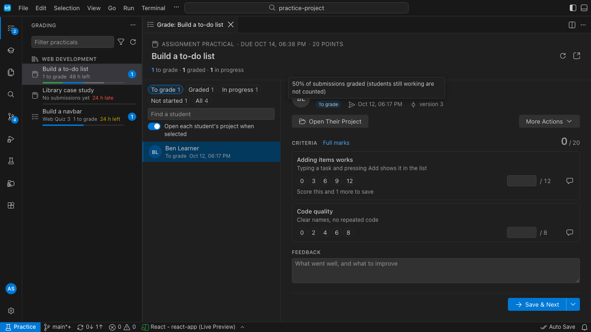 | 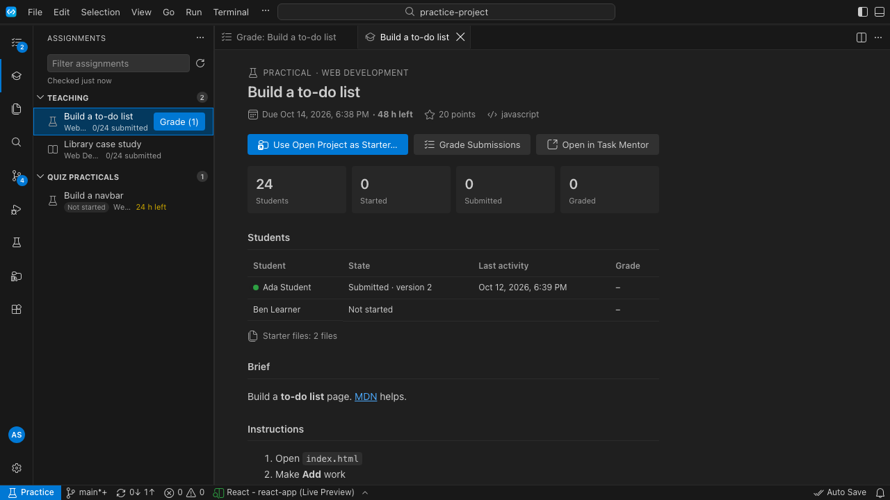 |

- After **Close Review**, the grading tab still shows Ben's criteria and **Save & Next**, but his code is gone ("Open Their Project"). Can the teacher grade now, or not (T5)?
- The assignment page reads three sources: the list says "0/24 submitted", **Grade (1)**, the cards say "0 Started · 0 Submitted", and the table says "Ada Student · Submitted · version 2" (T1).
- Its blue main button is **Use Open Project as Starter…**, a rare action that replaces the starter files for every student. **Grade Submissions** is secondary (T2).
- The teacher's Assignments view also lists **Quiz Practicals** as if they were a student, with "Not started" and **Start** (T6).

---

## Gaps

Severity: **P0** confuses or blocks most users; **P1** confuses many, or the work goes on with effort; **P2** polish.

### Students

| # | Sev | What the user sees | Why it hurts | Fix (arrangement, not features) |
|---|---|---|---|---|
| **U1** | **P0** | Messages that stay until closed pile up 3–4 high (plus "+1 more"). Stale ones ("returned" after graded, "Continue in your browser" after signing in) stay. They cover the brief's lower half and Home's **Start**. | The most important area of the screen is covered by old news. Users stop reading messages. | **One message per assignment** (a new state replaces the old: submitted → returned → graded). **Retire a message once its state is on screen** (the brief shows Graded, so the toast goes to the centre). **At most 2 on screen.** Sign-in messages replace each other. Messages go over the code column, never over the brief or Home's card. |
| **U2** | **P0** | "Saved online · just now" while typing; "Auto Save ✓" next to "Not saved yet"; "Save to Task Mentor" next to ⌘S. | Three saves (editor → disk → Task Mentor) with three vocabularies. Students can't answer "is my work safe?". | **One saving story for assignment workspaces:** ⌘S and Auto Save save to Task Mentor too (debounced), and the line says **Saving… / Saved · 2 min ago / Offline: saved on this computer**. Hide the "Auto Save" status item in assignment workspaces. The sync line counts unsaved editors as "not saved yet" right away. |
| **U3** | **P0** | At ≤ 1000 px: three columns, about 300 px of code, Submit below the fold. | The main action is invisible on common school laptops. | **Work mode layout:** when a brief opens beside code below 1200 px, the side bar folds (one click brings it back). The brief gets a **sticky footer** with its one primary button (as the grade panel already has). Below 900 px the brief becomes a tab that toggles with the code. |
| **U4** | P1 | Run / Live Preview replaces the brief in its column. | Save and Submit vanish exactly when the student checks their work. | The preview opens **below the code** (or in its own column), never in the brief's place. The brief tab is pinned. The editor title shows a small "Build a to-do list · In progress · Submit" bar whenever the brief is hidden. |
| **U5** | P1 | A second brief opens in a new column; Home opens inside the narrow brief column; brief tabs accumulate. | Users lose their place and can't tell which assignment the open folder is. | **One brief slot:** a single brief tab that is reused (like a preview tab) in the side column. Home always opens full width in the main column. A brief for an assignment other than the open folder shows "You're working on *Library case study*. Switch to this one?" with **Continue**. |
| **U6** | P1 | No-starter assignments open a nine-language picker that doesn't match the task. Closing it leaves an empty editor with **Submit** as the main button. | The first minute of the work is confusing, and the main action is wrong. | Offer templates **only for the assignment's language**; with no language, just "Empty project" or "Choose a template…". The empty workspace shows a **Create your first file** card in the editor. **Submit stays disabled** ("Nothing to hand in yet") until the project has a file. |
| U7 | P2 | Next up picks an overdue case study first, and its Start leads to the picker. | Reasonable rule, but the student doesn't know why this one comes first. | Say why on the card ("Late: due yesterday"). A small "Something else" link opens the To do list. |
| U8 | P2 | The same status shows 5–6 times on the working screen (side line, row chip, header, steps, card title, status bar). | It no longer contradicts, but the eye keeps re-reading the same word. | Keep it in **the brief (steps + card)** and **one side-bar line**. Drop it from the status bar (keep sync only) and from the row of the open assignment ("Open here" is enough). |
| U9 | P2 | Status bar with 12+ items (git branch, sync arrows, encoding, EOL, spaces, Live Preview, Auto Save, bell…). | Developer detail competes with the 2 items a student needs. | A **simple status bar** for students (default; Settings to show more): Practice · assignment sync · problems · Run · bell. |
| U10 | P2 | Nine unlabelled icons. The one-time pointer covers the filter. Source Control badge in non-assignment folders. | First-time users don't know where to click. | A **Student layout** (default for students): Assignments, Files, Search, Run; the rest under "More". Show the pointer beside the icon over the editor area, not over the side bar. |
| U11 | P2 | "Continue in your browser…" stays after sign-in; plus "Signed in to NGA as …". | Out-of-date message, and two messages for one event. | Replace by key. No toast when Home visibly changes. |
| U12 | P2 | Rows squeeze the course name to a sliver ("Returned \ 48 h left", "Web Developme…", "We…"). | Hard to scan. | Two-line rows (title / status · due). Hide the course when the student has only one. |
| U13 | P2 | The centre lists duplicates and keeps buttons that no longer apply. | Noise in the one place meant to be calm. | Group entries by assignment; the newest state wins; drop actions whose state changed. |

### Teachers

| # | Sev | What the user sees | Why it hurts | Fix |
|---|---|---|---|---|
| **T1** | **P0** | One practical, three numbers on one screen: "0/24 submitted", **Grade (1)**, "0 Started · 0 Submitted", and the table's "Ada · Submitted". | Teachers stop trusting the numbers. It's the teacher-side twin of the old W4 problem. | **One progress source** (the grading roster) for every teacher view. The assignment page shows the roster's counts, and each row opens that student in grading. |
| T2 | P1 | The assignment page's main (blue) button is **Use Open Project as Starter…**. | A rare action that replaces every student's starter files looks like the thing to do. | Main button **Grade (n)**. Starter files go under "…" with a confirmation. |
| T3 | P1 | The first student is "2 of 2"; after Save & Next, "1 of 1". | The counter follows the list order, not the grading order. | Sort "To grade" by grading order (oldest hand-in first) and show **"1 of 2 to grade"**, then "2 of 2". |
| T4 | P1 | Opening the student list pushes the grade panel down. | The teacher loses the form while choosing. | The list opens as a dropdown over the panel (anchored to the switcher), or beside it when wide. |
| T5 | P1 | After Close Review the grading tab keeps the form, without the code. | Unclear whether grading should go on. | Close Review also closes the grading tab (or replaces the form with "Review closed · **Open Their Project**"). |
| T6 | P1 | Teachers see the student-only Quiz Practicals list, with "Not started · Start". | Wrong audience, and a misleading Start. | Teachers see quiz practicals with grading counts (or not at all) in Assignments. |
| T7 | P2 | Reviews open `README.md` first. | Teachers want the code. | Open the entry file of the language (`index.html`, `main.*`, `app.*`) before README. |
| T8 | P2 | Home shows **Done** for a practical with no submissions. Grading shows red "24 h late" on a teacher's own assignment. | Wrong word; alarming colour with no action. | "No submissions yet"; a neutral due date for teachers. |
| T9 | P2 | The "Grade saved" message covers the Feedback box. | Covers the next thing to type. | The footer says it ("Saved Chloe 20/20 · now Ben"); no message. |
| T10 | P2 | Source Control badge (15) while reviewing. The pointer covers the Grading summary. | Noise. | Hide Source Control in review folders; move the pointer (see U10). |

---

## Proposed refactor: the arrangement

### A. Work mode (students and teachers)

```
┌─────────┬────────────────────────────┬──────────────────────┐
│ icons   │  code (the student's files)│  brief  /  grade     │
│ (side   │                            │  …                   │
│ bar     │  Run output: below the     │                      │
│ folds)  │  code, never over the brief│ ┌──────────────────┐ │
│         │                            │ │ ● In progress    │ │  ← sticky footer:
│         │                            │ │ Saved · 2 min    │ │    status + the ONE
│         │                            │ │ [Submit]         │ │    main button
└─────────┴────────────────────────────┴─┴──────────────────┴─┘
```

- Opening an assignment (or a review) enters work mode. The side bar folds below 1200 px, one brief slot, and a sticky footer with the one main button.
- Below 900 px the brief becomes a tab that toggles with the code; the footer stays.
- Leaving (Home, Close Review, opening another folder) restores the previous layout.

### B. One message per thing

- A message has an **owner** (`assignment:51`, `grading:51`, `account`). A new message from the same owner replaces the old one.
- When the owner's state is visible on screen (the brief or grade panel shows it), the message goes straight to the centre (unread if it came from outside), instead of a toast.
- At most two toasts. They are placed over the code column.

### C. One saving story

- In assignment workspaces, **saving the file saves to Task Mentor** (debounced 3–5 s, not 30 s). There is no separate "Save to Task Mentor" button, only a retry when it fails.
- The status says one thing: **Saving… · Saved · 2 min ago · Offline: saved on this computer, will send when online**.

### D. Simple student screen (default for students, switch in Settings)

- Activity bar: Assignments, Files, Search, Run; the rest under "More".
- Status bar: Practice · assignment sync · problems · Run · bell.
- No Source Control, Testing or Extensions unless turned on.

### E. One number for teachers

- The grading roster is the source for Home, the Grading view, Assignments rows, the assignment page and the switcher. The assignment page's table opens that student's grading.

---

## Plan

| Step | Items | Effort (1 dev) | Done when |
|---|---|---|---|
| **1. Calm the screen** | U1, U11, U13, T9 | 2–3 days | In the student journey test, at most 2 toasts are ever visible, none over the brief, and none stale (asserted at each step). |
| **2. One saving story** | U2 | 2–3 days | The journey asserts one save word on screen at every step. Typing shows "Saving…" within 1 s, and "Saved" within 5 s of a pause. |
| **3. Work mode** | U3, U4, U5, T4 | 4–5 days | At 900 × 640 and 1100 × 680 the main button is visible at every journey step (e2e). Run never hides it. Opening another brief reuses the slot. |
| **4. First minute** | U6, U7 | 1–2 days | A no-starter assignment offers only matching templates. Submit stays disabled until a file exists. |
| **5. Teacher numbers and grading order** | T1, T2, T3, T5, T6, T7, T8 | 2–3 days | All teacher views show the same counts (e2e compares them). The first student is "1 of n". |
| **6. Simple student screen** | U8, U9, U10, U12, T10 | 1–2 days | A student layout and status bar by default; a setting turns on the developer layout. |

**Total: about 12–16 developer days.** Steps 1–3 remove most of what the eye has to fight. Each step adds its own e2e assertions to the golden journeys, which already capture screenshots at every step for review.

## How to check it worked

- In the usability session (template in [baseline.md](../2026-10-12-workflow-gap-analysis/baseline.md)), add one question after each task: **"What would you click next?"** If the answer is the main button, the arrangement works.
- Journey tests: at each step, count visible toasts (≤ 2), visible status words (≤ 2), visible save words (1) and visible main buttons (1), at 1280 × 720 and 900 × 640.
