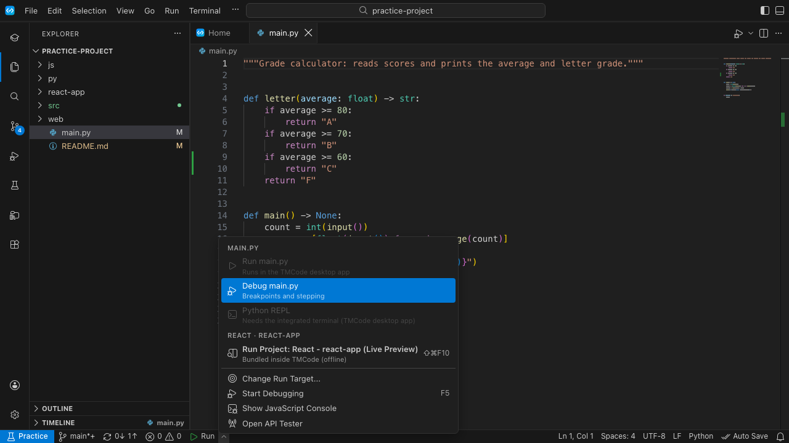
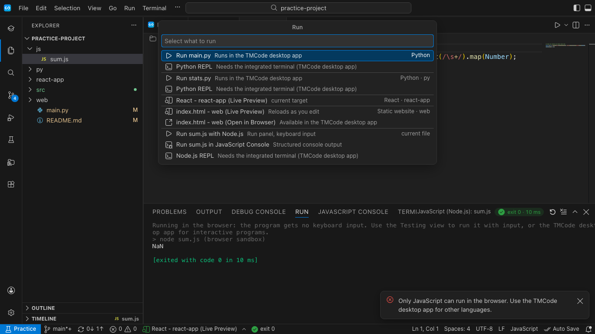
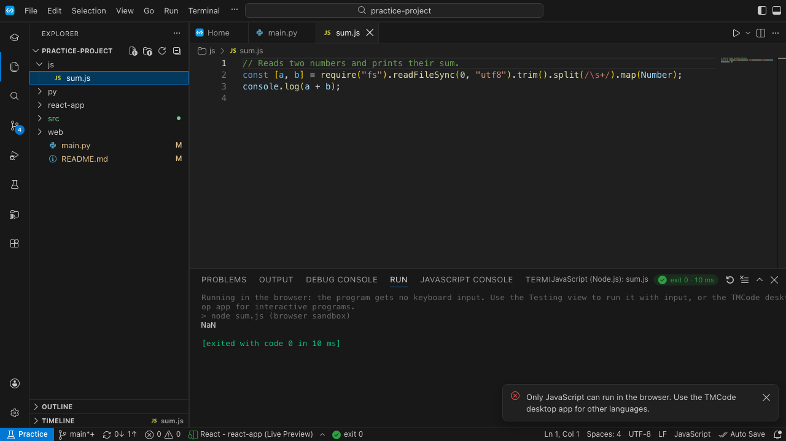
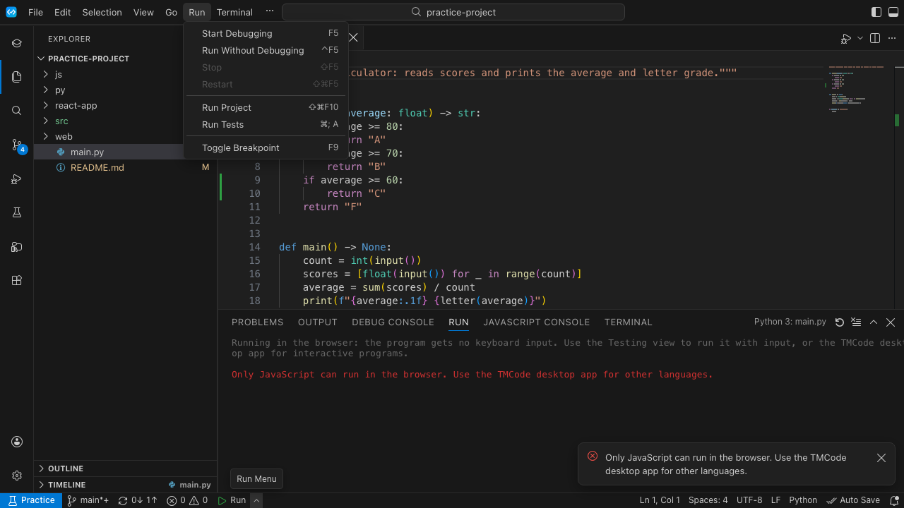

# Simplify and centralize: one place for every action, one smart Run and Test

**Date:** 12 October 2026 · **Version reviewed:** TMCode 0.15.0 · **Builds on:** [end-user walkthrough](../2026-10-12-end-user-walkthrough/README.md) (U1–U13, T1–T10)

## Summary

TMCode does a lot, but **almost every action can be done in many places, with different words, by different code**, and the user has to pick. This review counted every way ("door") to do each action and reviewed how running and testing work in each language. The pattern is the same everywhere:

| Action | Doors today | Words used | Code paths |
|---|---|---|---|
| See my assignments | 18 places | 3 status vocabularies; "to do" counted **4 different ways** | 4 |
| See what to grade | 15 places | "to grade" / "submitted" / "N drafts" | 3 lists, each sorted and grouped differently |
| Start / Continue | about 15 | Start, Start Assignment, Continue, Open My Work, Open in TMCode | 2 (one skips "save first?") |
| Submit | 5 | Submit, Submit…, Submit Again, Save and Submit | **3 implementations** with different dialogs |
| Sign in | about 14 | 6 wordings ("Sign in", "Sign In", "Accounts: Sign in"…) | 1 |
| Open in Task Mentor | 17 | 6 labels, 6 destinations | 5 URL helpers |
| Run code | 17 | Run, Run File, Run Without Debugging, Run Project, Run…, Start Debugging | **4 separate decisions** about what to run |
| Run tests | 12 | "Run All Tests" means two different scopes | 2 test systems |

The result, for a student: the screen keeps offering choices they don't need. And the **Run** button often runs *something other than the file they are looking at*.

**The fix is centralisation, not new features:**
- Every action gets **one home, one label, one function**. Alternatives exist only in the command palette (for keyboard users) and never as a second button.
- **Run and Test become two smart buttons.** Each picks its target with one explainable rule and says why ("Running main.py because it's the file you're editing").
- TMCode **checks for the language before running** and helps install it, for every language.

The plan below is roughly 15–20 developer days in five steps. It pairs with the walkthrough report's plan: that one calms the screen, this one removes the duplicate paths underneath.

---

## Part 1. One place for each thing

### 1.1 The map: where each action lives

**Rule:** one home and one button per action. Anything else is a palette command with the same wording, never a second button on screen.

| Action | The one home | The one label | One function | Today's extra doors become |
|---|---|---|---|---|
| **My assignments** (students) | **Assignments** view, which also includes quiz practicals | (view) | `studentTasks()`: assignments + quiz practicals, with the derived status | Home shows a *summary* of the same list (Next up + counters). The activity-bar badge counts from the same function. **All My Projects** becomes a folded "Other projects" section at the bottom of Assignments. |
| **What to grade** (teachers) | **Grading** view, which includes assignments *and* quiz practicals | (view) | `gradingQueue()`: roster-based, oldest hand-in first | Home's "To grade" card and Assignments' **Grade (n)** read the same queue. The teacher brief's numbers come from it too (fixes T1). |
| **Start / Continue** | The brief's next-step card (+ Home Next up, which *is* that card) | **Start** / **Continue** | `startAssignment()` for both assignments and quiz practicals | Row buttons stay (they say exactly Start/Continue). "Start Assignment", "Open My Work" and "Open in TMCode" are renamed to Start/Continue. Project rows and `tmcode://project` go through `startAssignment` when the project belongs to an assignment, so "save first?" is never skipped. |
| **Save** | Automatic. The brief shows the state. | **Saving… / Saved** | one save | The "Save to Task Mentor" button becomes **Try Again**, shown only after a failure. The side-bar "Save" button, the status-bar click-to-save and ⌥⌘U stay only as a palette command. The two "Auto Save" settings merge into one in assignment workspaces (walkthrough U2). |
| **Submit / Withdraw** | The brief's next-step card | **Submit** / **Submit Again** / **Withdraw to Edit** | **one** `submit(target)` (merging `submitAssignment`, `submitProject`, `submitQuizPractical`) | The row context-menu "Submit…" goes. The palette keeps "Submit". All doors show one dialog and refresh both lists. |
| **Brief / grade / feedback** | The brief tab (one reusable slot, walkthrough U5) | **Open Brief** | `showBrief(target)` | Toasts say **Open** (one word for "Show Brief" / "Open" / "View Feedback"). Add a palette command "Show Brief". |
| **Grade a submission** | The grading tab | **Save & Next ▾** | `openGrading()`, then the panel | Home, Grading rows, **Grade (n)**, the teacher brief and deep links all call `openGrading` (already true). Remove the second "Start Grading" inside the tab (it opens the first waiting student by itself). Add a palette command for "Return for Changes…" (it's now only under More Actions). |
| **Sign in / out** | The account button (bottom left) + Home's card when signed out | **Sign in** / **Sign out** | `signIn()` / `signOut()` | All other sign-in buttons say exactly "Sign in". "Sign In", "Accounts: Sign in" as a tooltip, and "Sign Out of NGA" in the Projects menu all go. |
| **Open in Task Mentor** | One entry in each object's "…" menu | **Open in Task Mentor** | `openInTaskMentor(target)`: assignment → assignment page, quiz → quiz page, grading → grading page | The 17 doors become 3 (the brief "…", the grading tab "…", the account menu). The 5 URL helpers become 1. |
| **Run** | The **Run** button (status bar and editor title show the **same** target) | **Run ‹what›** | `resolveRun()`, then `executeAction()` (Part 2) | F5, Ctrl+F5, Run File, Run Without Debugging, Run Again and the Run menu all go through the same resolver. "Run Project" and "Run…" stay as the menu and picker. |
| **Test** | The **Test** button beside Run | **Test ‹what›** | `resolveTest()` (Part 2) | The Testing view's "Run All", the palette and the CodeLens all call it with a scope. |
| **Open a folder / recent** | Home › Practise on your own (+ File menu) | Open Folder… | unchanged | Fix the wrong shortcut shown on Windows/Linux (Home and the watermark show Ctrl+O, which is Open File there). |

### 1.2 One definition for each number

These are the same questions answered differently in different places. Each must come from one function.

| Number | Today | Make it |
|---|---|---|
| Student "to do" | Activity badge: includes teacher-closed work, excludes quiz practicals. Home: excludes closed. Assignments "To Do": includes closed. `todoOf`: dead code. | `studentTasks().filter(isToDo)`, where to-do = not started / in progress / returned, **including quiz practicals**. |
| Student "graded" | Home excludes read-only; the Assignments filter includes it, then shows it under "Closed". | One rule: graded is graded, whether or not it's closed. |
| Statuses | 3 vocabularies: brief (6 words), All My Projects (draft/submitted/graded/removed), grading roster (To grade/Graded/In progress/Not started). | Student views use the 6 words of `status.ts`. The roster keeps its teacher words, but "In progress" means the same everywhere. |
| Teacher "to grade" | Home (counts drafts), Grading view (hides drafts), Assignments ("x/y submitted"), teacher brief (assignment counters). | `gradingQueue()` counts: **to grade**, **drafts**, **graded**, **in progress**, shown with the same words everywhere. |
| Quiz practicals | Students see them only in Assignments (not Home, not the badge). Teachers see them only in Grading. | They are tasks like any other: in Next up, counters, badge, Grade (n). |

### 1.3 Dead and broken paths to remove or fix

| Item | Where | Action |
|---|---|---|
| `submitFromView` never called | `projects/commands.ts:68` | delete |
| `StatusView.secondary` never rendered | `projects/status.ts:62,140` | delete, or use it for the "…" menu |
| `todoOf` / `todoSummary` used only in tests | `projects/studentHome.ts:111-126` | delete (replaced by `studentTasks`) |
| Unused catalog keys | `messages/catalog.ts` (`save.autoFailed`, `projects.allMine`, `projects.teacher`) | use them (the hard-coded copies) or delete |
| Home "Review Drafts" only reveals the Grading view | `grading/service.ts:294-302` | open the first activity with drafts, on its Release button |
| Home "Taking an exam?" does nothing outside practice mode | `WelcomePage.tsx:386-389` | hide it outside practice mode |
| Wrong Open Folder shortcut on Windows/Linux | `WelcomePage.tsx:362`, `EditorGroupView.tsx:257` | read the real binding (`keybindingFor`) |
| `tmcode://assignment` only shows the brief; `tmcode://project` opens the work | `assignments.ts:410-445` | both show the brief with Start/Continue (one behaviour) |
| Quiz rows have no context menu; Space opens a project row but only previews an assignment row | `AssignmentsView.tsx`, `ProjectsView.tsx:70-79` | same row behaviour everywhere: click/Space = brief, double-click/Enter = Start/Continue |
| Shift+F5 bound to three commands | `builtin.ts:267`, `debug/commands.ts:72`, `runHub.ts:600` | one `stop()` that stops whatever runs |
| "Run with Input File" has no UI | `run/runService.ts:163` | wire it into the Test button's examples (Part 2), or delete |

---

## Part 2. Running and testing every language

### 2.1 What a student meets today

| Run menu: the file is Python, the project target is React | The Run picker: 10 choices in 4 groups |
|---|---|
|  |  |

| JS reading input runs with no way to type | The Run menu (title bar): four run commands, three shortcuts |
|---|---|
|  |  |

*(Browser build: only JavaScript runs there, which is why Python shows an error. The desktop app runs every installed language. The design problems below come from the code and were reproduced with real compilers.)*

**Four buttons, four decisions about what to run:**

| Button | Decides with | Picks |
|---|---|---|
| Status-bar **Run** | `chooseTarget()` (`run/projectKind.ts:835`) | **Any project first**, then the file. Edit `main.py` in a folder that also has `react-app/`, and Run starts React. |
| Editor-title ▶ | `primaryFileAction()` (`run/runHub.ts:172`) | The file (your last choice for that extension) |
| **F5** | `startOrContinue()` (`debug/debugService.ts:984`) | The **debugger** if the language has one. First time: "Install debugpy?" |
| **Ctrl+F5** / Run File | `runFile()` → `targetFor()` (`run/runService.ts:34`) | Only Python, JS, TS, C, C++, Java, Go, Rust and HTML. **PHP, Ruby, Kotlin, C#, Dart, SQL and logic: "TMCode doesn't know how to run…"**, while ▶ runs them fine |

**Output goes to a different place depending on the language:**

| Language | Output and keyboard input |
|---|---|
| Python, C, C++, Java, Go | the **Run** panel; typing works |
| JavaScript | the **JavaScript Console**, *unless* the code reads input, then the Run panel. `prompt-sync` isn't recognised, so it fails in the console. |
| JavaScript with an `index.html` anywhere above it | a **Live Preview of that page** ("Run with Node" isn't even offered) |
| PHP, Ruby, Kotlin, C#, Dart | a **terminal** |
| HTML, React | a preview tab |
| SQL, logic | a results tab |

### 2.2 Per language

| Language | ▶ runs | Problems found (★ = reproduced on this Mac with the real toolchain) | Tests |
|---|---|---|---|
| **Python** | `python -u file`, Run panel, input works | F5 = debugger, which asks to install debugpy on first use. A folder with `main.py` always runs `main.py` from the status bar, even with another `.py` open. | pytest (detected); plain `unittest` files are sent to pytest, so a missing pytest blocks them. A `tests/` folder gives **two** suites. Tests use `python3`, not the interpreter the student selected. |
| **JavaScript (Node)** | JS Console or Node, by guess | An `index.html` above turns `.js` into a page preview. `prompt-sync` is missed. ▶ = console while Ctrl+F5 = Node. | jest / vitest / node:test, only with a `package.json` |
| **TypeScript** | Node `--experimental-strip-types` | Node older than 22.6 fails with a raw error. `.tsx` without `index.html` is "doesn't know how to run". | as JS |
| **HTML/CSS/JS** | Live Preview | Good; works in exams | — |
| **React / Vite** | status bar: `npm run dev` (needs internet + `npm install`); editor ▶: TMCode's offline bundle | Two buttons run the same app two different ways. The offline bundle only knows React, so react-router or axios gives "Build failed". | Vitest / Jest |
| **PHP** | file: `php x.php` in a terminal; folder: **`php -S localhost:8000` web server** ★ (a CLI "echo Hello" exercise starts a web server from the status bar) | Ctrl+F5: "doesn't know how to run". F5 downloads Xdebug tooling. Missing PHP → the shell's "command not found" only; PHP isn't in Check My Computer. | PHPUnit only if `composer.json` mentions it; Laravel `artisan test` |
| **Java** | `javac -d out` **every .java below the folder**, then `java -cp out <File>` | ★ **One broken file from last week stops every run** ("1 error" in Broken.java while running Hello.java). ★ **A `package` line makes Run fail:** "Could not find or load main class App". A plain Maven project runs the *file* with javac and ignores the pom. | Maven / Gradle JUnit only; no tests for single files |
| **Kotlin** | `kotlinc … -d tmcode-kotlin.jar` in a terminal | Writes a jar into the student's folder. Ctrl+F5 unknown. Missing kotlinc → raw error. | Gradle only |
| **C / C++** | `cc … {every .c below the folder}`, Run panel, input works | ★ **Two exercises with `main()` in one folder can't build:** "ld: 1 duplicate symbols". A Makefile or CMake project is ignored by the status bar (it compiles the file instead). | I/O tests only (hand-written JSON) |
| **C#** | `dotnet run file.cs` in a terminal | Needs .NET 10; older SDKs fail with a raw error | xunit / nunit / MSTest with a `.csproj` |
| **Go** | builds **only the entry file** | A `package main` split over files fails ("undefined: helper"). `go.mod` CLI projects are ignored by the status bar. | `go test` |
| **Ruby / Rails / Sinatra** | terminal / dev server | Ctrl+F5 unknown; missing Ruby → raw error | RSpec, minitest |
| **Dart / Flutter** | terminal; Flutter web dev server | the status bar skips all Dart actions (they are "tasks") | `dart test`, `flutter test` |
| **SQL** | built-in SQLite, tables | Good; works offline and in exams. F5 / Ctrl+F5 "doesn't know how to run". | — |

**When the language isn't installed** there are three different kinds of help, depending on how you pressed Run:
- **Run panel languages:** a message with **Check My Computer** and **Refresh Toolchains**.
- **F5:** an install card with the exact `winget` / `brew` / `apt` command.
- **Terminal languages (PHP, Ruby, Kotlin, C#, Dart, Maven, Gradle, npm…):** only the shell's own `zsh: command not found: php`, which a 15-year-old won't understand.

Check My Computer only lists Python, Node, C, C++, Java, Go and Rust.

**Tests live in two systems:**
- **"Sample tests"** (input → expected output, `.tmcode/tests.json` written by hand, or the exam's visible tests).
- **"Project tests"** (pytest, JUnit, jest…, through a separate process host, off in exams).

They have different buttons and messages, and "Run All Tests" means a different scope in the Testing view than in the palette. Tests only appear after a first run (no discovery).

### 2.3 The smart Run and Test design

#### One Run button

`resolveRun(ctx) → { action, reason, alternatives }` replaces `chooseTarget()`, `primaryFileAction()` and `targetFor()`. **Every** entry point uses it: status bar, editor ▶, F5, Ctrl+F5, Run File, Run Again, Run with Arguments, Run menu.

Decision order, first match wins:

1. **Your pin.** A target you chose with "Change Run Target…", if it belongs to the project of the file you're editing. The pin is kept per project folder, not per workspace. → *"You chose this"*
2. **The exam task or assignment.** The task's main file, with the profile Task Mentor sent. → *"This task's main file"*
3. **The file's own project.** The deepest project folder that contains the active file, and its "run" action. That now **includes** `make run`, `gradle run`, `mvn exec:java`, `go run .`, `dotnet run`, `dart run` and `npm start` (each tagged `role: run`; build, test and lint are tagged separately and never picked as Run). → *"react-app is a Vite + React project"*
4. **The file itself**, with fixed rules:
   - `.js` previews a page only if that page's `index.html` actually loads it.
   - `prompt-sync` counts as reading input.
   - PHP, Ruby, Kotlin, C#, Dart, SQL and logic are known everywhere, Ctrl+F5 included.
5. **The only project in the workspace.** → *"The only project here"*
6. **Nothing.** A short picker that says why.

**What the student sees:**
- The **Run** button label is the thing it will run: "Run main.py", "Run react-app (npm run dev)". The tooltip and the first line of the output give the reason: *"▶ Running main.py because it's the file you're editing."*
- The ▾ menu lists the alternatives, grouped by project, plus **Debug** (an explicit choice).
- **F5 = Run.** Debugging is a choice in the ▾ menu, or F5 once breakpoints exist. No "install debugpy" prompt unless you chose Debug.
- **One stop:** Shift+F5 stops whatever is running.
- **Output always starts in the Run panel.** Terminal-based and dev-server runs print their first line there with **Show terminal**, so the student always knows where to look. Keyboard input works in the Run panel for every language that reads it (PTY).

#### One Test button

`resolveTest(ctx)` sits beside Run as **Test ‹what›**, with a "3/4 passed" badge:

1. In an exam, or when the assignment ships sample tests → **the sample tests** (Task Mentor runs them if a tool is missing, as today).
2. The active file is a test file → **that file's tests**.
3. The file's project has a test framework → **that project's tests**.
4. Otherwise → the sample tests of the Run target, and if there are none, a one-line way to add them: **Add an example** (input + expected output, written by TMCode, no JSON by hand).

Framework fixes:
- real `unittest` when pytest isn't installed;
- one suite per test folder (no duplicates);
- the selected interpreter;
- `node --test` without `package.json`;
- JUnit for single Java files (javac + `junit-platform-console-standalone`, as an optional download);
- C/C++ via sample tests.

#### Check before running, for every language

`preflight(action)` runs before anything starts:
- Each action knows the tools it needs (PHP, Ruby, Dart, Flutter, kotlinc, dotnet, Swift, Maven, Gradle, npm, Composer, Bundler, CMake, make, in addition to the eight checked today).
- If one is missing, nothing starts. One shared card appears in the Run panel: *"To run PHP files, TMCode needs PHP. It isn't on this computer yet."* with **How to install** (the exact command for this computer), **Check again**, and in exams **Run on Task Mentor**.
- The Run panel, F5, tests and dev servers all use this same card.
- Check My Computer lists every language TMCode can run.

#### Build fixes

| Fix | Where |
|---|---|
| C/C++: compile the entry's folder only, and if several files define `main`, only the entry file | `apps/desktop/src-tauri/src/runner.rs` `sources()` / `expand()` |
| Java: compile the entry's folder only; run `java -cp out <package>.<Class>` (share `javaMainClass()` from the debugger) | `runner.rs`, `debug/debugService.ts:719` |
| Go: build the entry's package (`go build ./<dir>`), not one file | `packages/profiles` (go) |
| Kotlin: put the jar in TMCode's build folder, not the student's | `run/projectKind.ts:631` |
| TypeScript: check `node --version` ≥ 22.6, else explain | `preflight` |

---

## Part 3. Plan

| Step | What | Effort | Done when (e2e or unit) |
|---|---|---|---|
| **1. One Run** | `resolveRun` + reasons; every run door goes through it; F5 = Run; one Stop; Run-panel first line | 4–5 days | Unit: a table of (workspace layout, active file, pin, exam) → target + reason, covering the py/js/react-app demo, PHP CLI vs a PHP site, Maven, a Makefile, a multi-task exam. e2e: status bar and editor ▶ show the same target for 10 sample files. |
| **2. Build fixes + preflight** | runner `sources` / Java package / Go package; tool detection for all languages; one install card | 3–4 days | Rust tests: a two-`main` C folder builds the entry only; a Java `package` runs; a Go multi-file package runs. A missing tool shows the card with the right command, for each language. |
| **3. One Test** | `resolveTest`; Test button + badge; unittest, de-duplication, interpreter, node:test; "Add an example" | 3–4 days | Real-toolchain smoke (the existing scratch smoke script): pytest, unittest, jest, node:test, JUnit, go test, PHPUnit all report pass/fail in the Testing view from the one button. |
| **4. One home per action** | Merge Projects into Assignments (students); one `submit()`; one `openInTaskMentor()`; Start/Continue everywhere; labels and casing; Shift+F5 | 3–4 days | Doors e2e: each canonical action has exactly one visible button at every journey step; the glossary test checks labels. |
| **5. One number per question** | `studentTasks()` (quiz practicals included), `gradingQueue()`; badge, Home, lists and teacher brief read them; dead code removed | 2–3 days | Unit: the counts table; e2e: badge = Home To do = Assignments To Do; Grade (n) = Grading view = Home. |

**Total: about 15–20 developer days.**

**Suggested order with the walkthrough's plan:**
1. Calm the screen: walkthrough step 1 (messages).
2. One Run: this report's step 1.
3. One saving story: walkthrough step 2.
4. Work mode: walkthrough step 3.
5. Then the rest, by need.

Steps 2–4 above (one Run, one save, work mode) are what students feel most every day.

## How to check it worked

- **"What would you click next?"** after each task in the usability session: the answer should be the one main button.
- **"Which file will Run run?"** asked before pressing Run, in a folder with two languages: the student's guess should match the button's label 5 times out of 5.
- **Missing language:** a student on a computer without PHP gets PHP installed and running using only what TMCode shows them, without asking the teacher.
